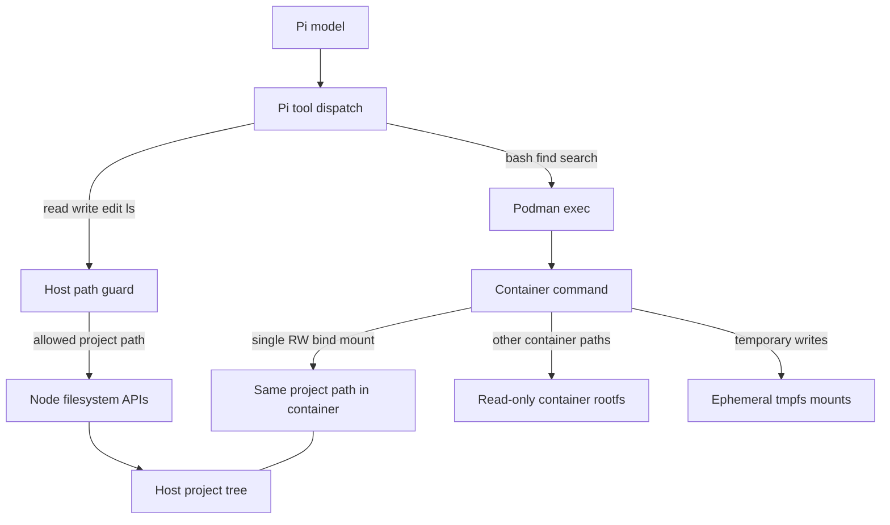
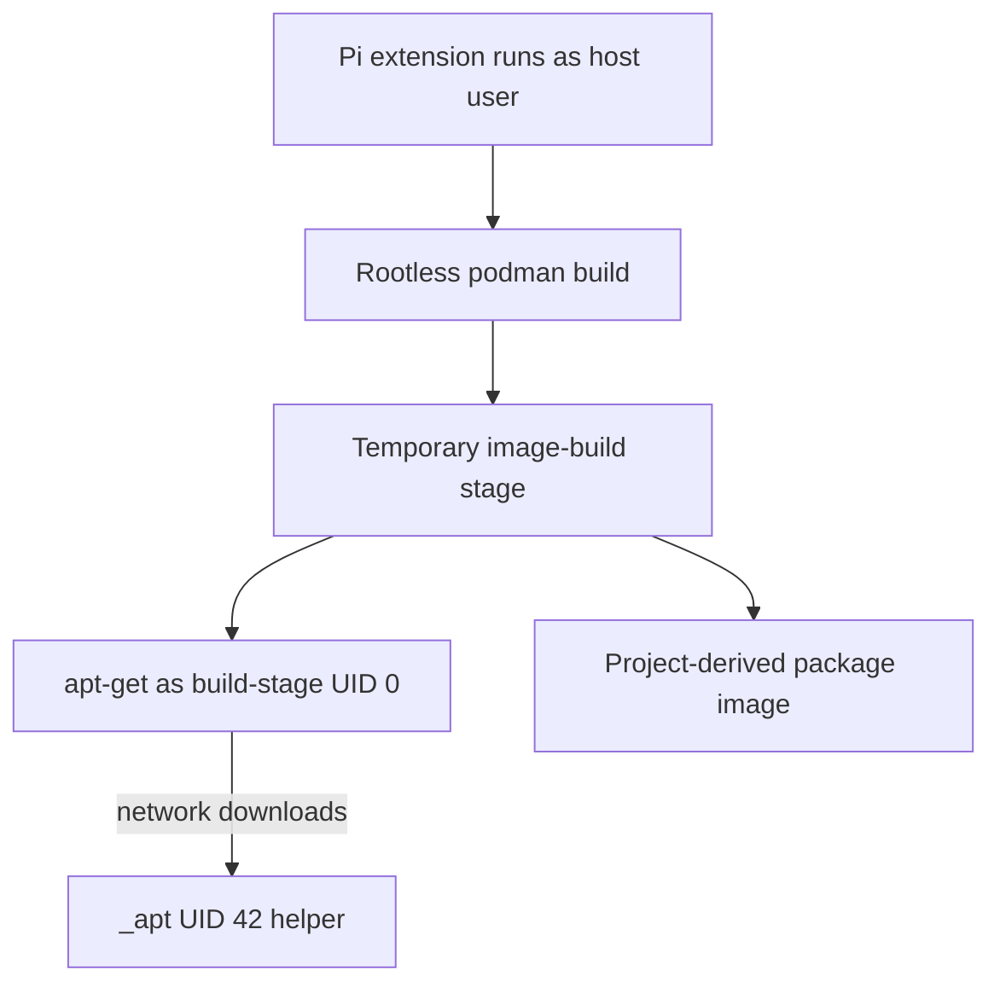
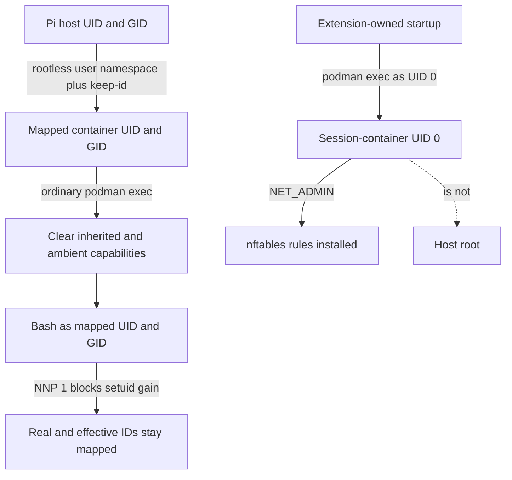
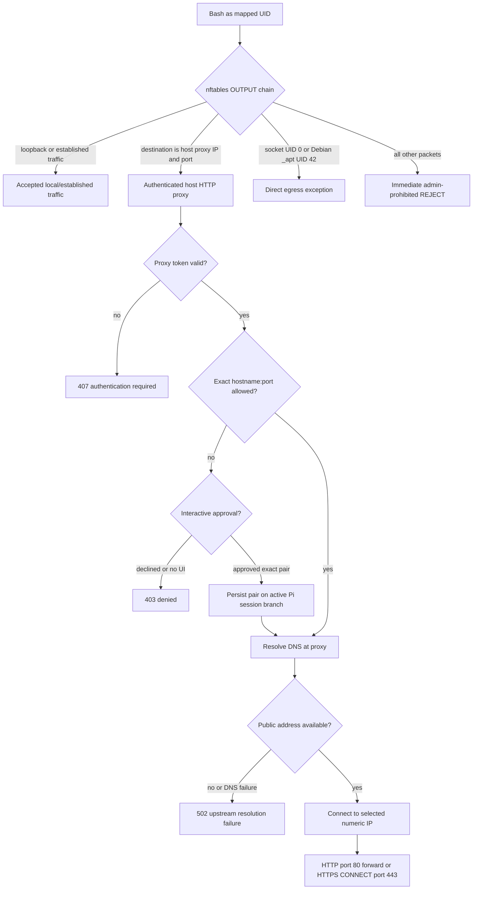
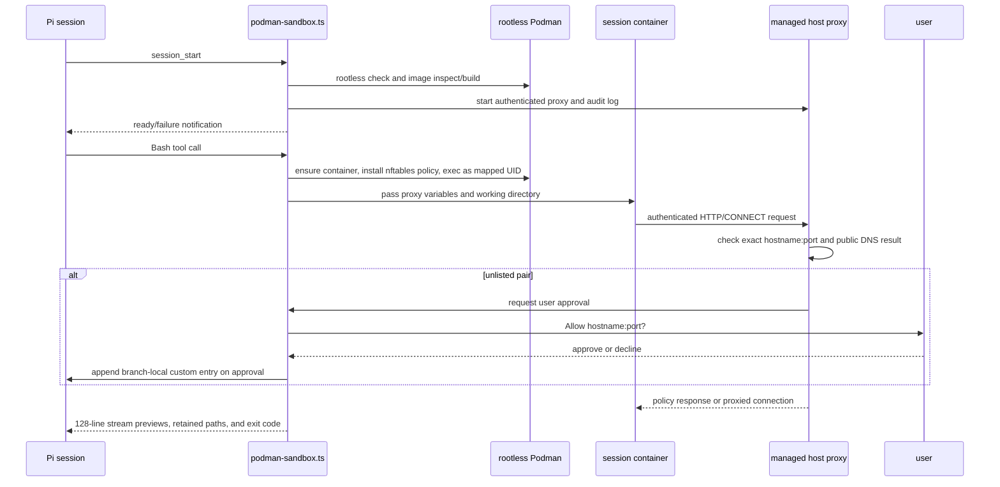

# Pi Podman Sandbox Extension Specification

## Overview

The Pi Podman Sandbox extension replaces selected coding tools with project-aware file operations and rootless Podman execution. It confines container commands to a read-only container root filesystem, the current writable project mount, ephemeral scratch mounts, and a monitored HTTP proxy whose egress policy is exact-hostname-and-port based. Package state, output capture, user approvals, lifecycle behavior, and test boundaries are specified here as the system-level contract; the image-layer details are also covered by [01_SANDBOX_IMAGE_LAYERS.md](01_SANDBOX_IMAGE_LAYERS.md).

## Motivation

Pi coding tools normally run in the agent process and have the host user's privileges. This extension moves shell, find, and native source search into a rootless Podman container, while retaining compatible Pi file tools with explicit project-root path guards. It also separates immutable base tools from project package additions and blocks direct network egress from ordinary shell commands.

The extension is a local development containment boundary, not a complete hostile-code sandbox. The project mount is writable by design, Pi file callbacks remain host-side, the proxy permits user-approved destinations, and other extensions continue to run in the Pi process. These boundaries and limitations must be visible rather than hidden behind the word "sandbox."

## Goals

- Execute Bash, native search, and find in a rootless Podman container associated with the current project and Pi process.
- Preserve Pi's normal tool schemas and renderers where the exported tool factories permit it.
- Keep persistent writes to the project mount; make non-project scratch paths ephemeral and the container root filesystem read-only.
- Enforce proxy-only egress for the mapped Bash identity at the container network layer.
- Allow network destinations only as exact normalized DNS hostname/port pairs; bare CLI hostnames mean HTTPS/443, and HTTP/80 requires explicit `:80`.
- Require user confirmation for an unlisted pair in an interactive UI and store approval only in the active Pi session branch.
- Manage project package additions through a host-side manifest and derived Podman image layers, never by letting Bash mutate package state.
- Keep Bash output bounded in Pi context while retaining long output in ignored, project-readable files.
- Provide status/help output and provider-free tests for the relevant trust boundaries.

## Non-Goals

- This design does not claim a complete security boundary against a hostile host user, another host process running as the same UID, or every kernel/Podman vulnerability.
- It does not move Pi `read`, `write`, `edit`, and `ls` filesystem operations into the container; those are guarded host-side capabilities.
- It does not deny network egress to root and Debian `_apt` identities inside the container network namespace. The ordinary Bash path runs as the mapped UID; package builds use Podman's build path.
- It does not inspect HTTPS payloads, install a TLS interception certificate, or log encrypted content.
- It does not add network bandwidth quotas, connection-rate limits, or general denial-of-service controls.
- It does not guarantee lossless package-manifest updates across concurrent Pi processes using the same project.
- It does not manage global Podman storage, unrelated containers/images, or run `podman system reset`.
- It does not publish the extension as a package or load it implicitly from the project. Loading remains explicit unless the user installs a symlink in a supported Pi extension directory.

## Design

## Terminology and Trust Boundaries

| Term | Meaning |
|------|---------|
| Project root | `process.cwd()` resolved to an absolute path when the extension initializes. It is the boundary for host-side path checks and the only persistent container mount. |
| Base image | The image selected by `--sandbox-image`, or the extension-owned image built from its embedded Containerfile. |
| Project package state | The host-cache manifest containing sorted explicit Debian package names and an `upgraded` flag. It is not mounted into the container. |
| Runtime image | The base image optionally followed by the project's upgrade image and explicit-package APT image. |
| Session container | The rootless Podman container running for the current extension process. Its writable layer is not the package persistence mechanism. |
| Destination | One canonical DNS hostname paired with exactly port 80 or 443. `example.com:80` and `example.com:443` are distinct destinations. |
| Branch approval | A Pi custom session entry authorizing one exact hostname/port pair on the entry's active branch ancestry. |
| Host callback | A Pi tool operation such as read/write that uses the Pi host process and Node filesystem APIs after a project-root check. |
| Proxy audit record | A JSONL record written by the host-side proxy for an HTTP request or HTTPS CONNECT attempt, including policy decision and observed byte counters. |

### File-access boundary



The guard checks canonical paths before host filesystem operations; it is not an atomic descriptor-based sandbox. The container gets the project mount and its own root filesystem, not arbitrary host paths. Pi `read`/`write`/`edit`/`ls` remain host-side capabilities and should not be confused with container operations.

### UID and privilege boundary

UID 0 appears in two distinct places in this design. The first graph is the temporary build stage used for APT image creation; the second is the long-running session container where UID 0 is used only by extension-owned firewall setup. The ordinary Bash identity is shown with the session-container path, not mixed into the APT graph.

#### UID 0 during APT image builds



The package manifest is consumed by Podman's rootless image-build path. `apt-get` runs as UID 0 within that temporary build stage and uses Debian `_apt` UID 42 as its network-download helper. This is not the long-running Bash container; package traffic uses Podman build networking.

#### UID 0 during session firewall setup



The session container is created with all capabilities dropped except `NET_ADMIN`, which extension-owned startup uses to install nftables. Ordinary commands always use the mapped host UID/GID through `setpriv`; integration tests assert zero effective capabilities and `NoNewPrivs: 1`. Container UID 0 is namespace root, not host root. The runtime firewall retains direct-egress accepts for socket UIDs 0 and 42, but ordinary Bash runs as neither identity and package installation does not execute in this container. The network diagram below shows how those UID exceptions relate to the proxy path.

### Network-egress boundary



The nftables chain defaults to DROP and ends with an explicit REJECT after its accepts. For the mapped Bash identity, only the proxy endpoint is allowed directly; DNS and alternate ports cannot bypass the proxy. The proxy matches exact pairs: a bare CLI hostname means `:443`, while HTTP requires a separate `:80` entry. Approval prompts contain only the detected `hostname:port`; HTTPS payloads pass through encrypted and are not inspected. APT image builds use Podman's build networking and are separate from ordinary Bash egress.


## Architecture

### Components

| Component | Responsibility |
|-----------|----------------|
| `podman-sandbox.ts` | Registers replacement tools, guards host callback paths, manages images/container/firewall, routes Bash output, manages package state, exposes `/sandbox`, and restores session-branch egress approvals. |
| `egress-proxy.ts` | Normalizes destination allowlists, authenticates proxy clients, validates destination/port and resolved addresses, proxies HTTP/CONNECT, awaits approval callback for unlisted pairs, and writes audit records. |
| Embedded Debian image recipe | Provides Bash, core utilities, Git, Python, ripgrep, `file`, `find`, nftables, and util-linux/setpriv. |
| Host package manifest | Persists explicit package names and upgrade intent per project, outside the workdir mount. |
| Host `.out/` directory | Stores complete Bash stdout/stderr for streams over the inline threshold; ignored by a locally created `.gitignore`. |
| `poc/test-podman-sandbox-rpc.py` | Starts a provider-free Pi RPC process; isolates package/image state per run; runs smoke or security suite and cleans only its own resources. |
| Security/proxy PoCs | Verify path, identity, filesystem, egress, package, output-capture, approval, and proxy behavior without a model provider. |

### Data flow



## Extension Activation and Configuration

### Activation

Load the extension explicitly:

```sh
pi -e ./podman-sandbox.ts
```

A user may instead symlink the extension into a project `.pi/extensions/` directory or `~/.pi/agent/extensions/`. Project-local extension trust rules apply. A global installation replaces the standard tools in every project in which it loads.

### Flags

| Flag | Type | Contract |
|------|------|----------|
| `--sandbox-image <local-image>` | string | Select an already-local custom base image. The extension does not pull a missing custom image automatically. It must support the embedded runtime contract; APT operations additionally require Debian APT. |
| `--sandbox-verbose` | boolean | Log extension lifecycle, image, container, command-class, and audit-path milestones without printing complete user command text. |
| `--sandbox-egress-allow <entries>` | string | Comma-separated exact DNS destinations. Each entry is `hostname` (default port 443), `hostname:443`, or `hostname:80`. Only ports 80 and 443 are valid. |
| Pi `--verbose` | boolean | Also enables extension milestone logs. |

Example:

```sh
pi -e ./podman-sandbox.ts --sandbox-egress-allow github.com,api.github.com:80
```

This allows `github.com:443` and `api.github.com:80`; it does not allow `github.com:80` or `api.github.com:443`. Configure both pairs explicitly if both protocols are needed for one host. Hostnames are lowercased, IDNA-normalized to ASCII, and have a trailing dot removed. IP literals, invalid DNS names, and arbitrary ports are rejected.

### Test-only environment variables

| Variable | Purpose |
|----------|---------|
| `PI_SANDBOX_PACKAGE_PROJECT_ID` | Overrides package/image project namespace. Used by tests to keep derived tags isolated. |
| `PI_SANDBOX_PACKAGE_STATE_DIR` | Overrides package manifest directory. Used by tests to avoid touching the developer manifest. |
| `PI_SANDBOX_HOST_CANARY` | Security-test-only canary token. |
| `PI_SANDBOX_FIXTURE_ID` | Security-test fixture and derived-image namespace identifier. |
| `PI_SANDBOX_SECURITY_OUTSIDE`, `PI_SANDBOX_SECURITY_TMP` | Locations for disposable host canaries, always outside the project mount. |

These are harness controls, not user configuration APIs.

## Pi Tool Contract

The extension uses Pi's exported factories for the standard read/write/edit/ls/find/grep/bash schemas and renderers where possible. The extension registers a custom native `search` tool and a package tool named `sandbox`.

| Tool | Execution boundary | User/model behavior |
|------|--------------------|--------------------|
| `read` | Host filesystem callback after project path guard | Read project files and images. Existing path must resolve below project root. |
| `write` | Host filesystem callback after project path guard | Write/create project files and directories. A new file is checked through its canonical parent directory. |
| `edit` | Host filesystem callbacks after project path guard | Read and modify files within project. |
| `ls` | Host filesystem callbacks after project path guard | Enumerate project directories and stat project paths. |
| `find` | `find . -print` inside container, with host-side result filtering | Project-root traversal with the Pi factory's pattern and limit interface. |
| `search` | ripgrep JSON mode inside container | Regex by default; optional literal, case-insensitive, glob, project-relative path, and result limit. Returns structured matches and truncation status. |
| `grep` | Legacy Pi factory, hidden exposure | Not model-visible. Its backend traversal is not treated as containerized. |
| `bash` | Podman exec as mapped UID/GID | Executes user command string in project cwd with controlled proxy environment and split output capture. |
| `sandbox` | Host extension package/image management | Model-callable operations are only `{ "list": true }` and `{ "pkg_add": "<debian-name>" }`. Removal, upgrade, refresh, reset, and status remain user slash commands. |

### Host path guard

The project root is resolved once from the extension process cwd. Existing paths are canonicalized with `realpath`; new destinations are checked by resolving their existing parent and retaining the basename. Directory APIs also verify that the canonical target is a directory. This rejects common absolute-path, traversal, and symlink escapes.

This check is not atomic with the subsequent Node filesystem call. A host process that can race the filesystem may exploit TOCTOU conditions, and a host-created hard-link alias inside the project still refers to the same inode as its outside alias. Those are explicit limitations of host-side callbacks, not claims about what a command in the container can create from an unmounted source. Keep callback tests separate from container-escape tests.

### Native search contract

- Default result limit: 50 lines; allowed `limit`: 1 through 200.
- Query is a ripgrep regular expression unless `literal` is true.
- Optional `ignoreCase`, `glob`, and project-relative `path` are supported.
- ripgrep uses `--json`, `--no-follow`, and a 400-column display bound.
- Captured subprocess output is capped at 1 MiB independently of the match count.
- Results are `{ path, line, text }` records relative to the project root. The output contains `path:line: text`; `structuredContent` contains `matches` and `truncated`.
- Ignore-file behavior is preserved. The tool does not disable `.gitignore` rules to make fixtures visible.

## Container and Process Contract

### Image roles

The image graph and package-layer contract are specified in [01_SANDBOX_IMAGE_LAYERS.md](01_SANDBOX_IMAGE_LAYERS.md). The operational rules are:

1. The embedded base tag is derived from a SHA-256 hash of the embedded Containerfile text, truncated to 16 hex characters.
2. A custom base image must already exist locally. A missing extension-owned default image is built from a temporary on-disk Containerfile and temporary build context.
3. If `upgraded` is true, derive a project upgrade image with `apt-get update && apt-get upgrade -y` from the selected base.
4. If explicit packages exist, derive a project APT image from the current parent image with one `apt-get update` and one `apt-get install --no-remove -y --no-install-recommends <complete-sorted-list>` invocation.
5. Image tags include project namespace and a content-derived key. APT image keys depend on parent image and complete package list; upgrade tags depend on project and base image.
6. Podman's normal layer cache is used for ordinary adds and reset. `refresh` bypasses the derived APT layer cache; `upgrade` bypasses upgrade and dependent APT caches.

The embedded base currently includes `bash`, `ca-certificates`, `coreutils`, `findutils`, `file`, `git`, `nftables`, `python3`, `python-is-python3`, `ripgrep`, and `util-linux`. Custom images must provide at least the tools required by the enabled operations, including nft, getent, setpriv, find, rg, file, and APT where packages are managed.

### Package manifest

Default manifest path:

```text
${XDG_CACHE_HOME:-~/.cache}/pi-sandbox/projects/<project-id>/packages.json
```

By default, `<project-id>` is an 8-character hash of the absolute project root. The manifest is outside the mounted project. Its shape is:

```json
{
  "packages": ["curl", "ripgrep"],
  "upgraded": false
}
```

Requirements:

- Package names match `^[a-z0-9][a-z0-9+.-]*$`.
- Package lists are unique and sorted before image derivation.
- Manifest parent directories are created with mode `0700`; temporary manifest files use mode `0600` and are atomically renamed into place.
- The candidate derived image is built before changed package state is published.
- No cross-process lock is implemented. Concurrent project sessions can lose updates; this is best-effort behavior and must not be described as serialized.
- Package names in the manifest represent explicit requests only, not base packages or transitive dependencies.

### Container creation and execution

The session container is named with a sanitized project basename, a short absolute-project-path hash, the Pi extension process PID, and a random suffix. The container is created with:

- `--userns=keep-id` and explicit `--user <host-uid>:<host-gid>`;
- one read-write bind mount of the project at the same absolute path;
- `--read-only` root filesystem;
- ephemeral `/tmp`, `/var/tmp`, and `/run` tmpfs mounts with `nosuid,nodev`;
- `--cap-drop=ALL` plus `--cap-add=NET_ADMIN` for extension-owned firewall installation;
- `--security-opt=no-new-privileges`;
- `--pids-limit=512`;
- a long-running `sleep infinity` process as the container init.

After creation, extension-owned startup resolves `host.containers.internal`, installs the nftables rules as container UID 0, and marks the container ready only after successful firewall installation. On failure the just-created container is force-removed. Ordinary command execution always names the mapped UID/GID and invokes `setpriv --inh-caps=-all --ambient-caps=-all -- sh -lc <command>`. No model-visible argument selects another UID.

### Lifecycle

| Event/action | Required behavior |
|--------------|-------------------|
| `session_start` | Read flags and package manifest; restore allowlist from CLI plus active branch; verify rootless Podman; ensure base/derived image; create host proxy and audit log; notify ready or startup failure. |
| First container-backed operation | Create session container, install firewall, and only then mark it started. |
| Package image mutation | Build candidate image from complete state; replace this process's session container if package state/image changes; next command starts against new runtime image. |
| `/sandbox reset` | Wait for an in-progress start; remove this extension process's current container; remove derived APT/upgrade image tags in the project's package namespace; rebuild derived image chain from retained base and package manifest. Never remove the base image or call global Podman reset. |
| `session_tree` | Rebuild effective egress allowlist from CLI entries and active branch entries; update the approval callback context. |
| `session_shutdown` | Remove this process's session container if started and close proxy sockets/server. The base and derived images, package manifest, and proxy audit file are not implicitly deleted. |

A derived tag still used by another container cannot be removed. Reset must report Podman's failure rather than force-removing another session's container. Because reset removes this process's own container before trying image removals, an image-in-use failure can leave the session container stopped while package manifest/images remain. A subsequent sandbox operation can recreate the container if the runtime image is still available.

## Network Egress and Proxy Contract

### Firewall

The container OUTPUT chain has default policy DROP and installs rules in this order:

1. accept loopback;
2. accept established/related traffic;
3. accept traffic with socket UID 0;
4. accept traffic with socket UID 42 (`_apt` on Debian);
5. accept IPv4 TCP to the resolved host gateway and the managed proxy's ephemeral port;
6. reject everything else with `icmpx type admin-prohibited`.

The explicit final REJECT is for prompt failure; the default DROP remains the fail-closed chain policy. Ordinary Bash runs as the mapped UID and therefore gets only the proxy endpoint rule. Root and `_apt` direct egress are exceptions in the namespace. APT image builds run separately through Podman build networking and are not Bash egress.

### Allowlist and transport matrix

| Request | Default proxy port | Required key | Result |
|---------|---------------------|--------------|--------|
| CLI `example.com` | n/a | `example.com:443` | HTTPS only |
| CLI `example.com:443` | n/a | `example.com:443` | HTTPS only |
| CLI `example.com:80` | n/a | `example.com:80` | HTTP only |
| HTTP absolute-form request | 80 | `<normalized-host>:80` | Forward after auth, allowlist and DNS validation |
| HTTP request on other port | other | none | 403; no approval prompt |
| HTTPS CONNECT | 443 by default | `<normalized-host>:443` | Tunnel after auth, allowlist and DNS validation |
| CONNECT on other port | other | none | 403; no approval prompt |
| IP-literal destination | request-derived | none | Rejected |

Each pair is independent. A user approval for `example.com:80` does not allow `example.com:443`; a bare CLI host supplies only the 443 pair.

### Interactive approval

When an authenticated proxy request on port 80 or 443 is valid but the pair is not allowlisted:

1. The proxy passes normalized hostname and port to the extension callback before resolving DNS.
2. The extension fails closed if there is no UI, the hostname/port fails parser validation, the user declines, or the Pi session branch leaf changes while confirmation is pending.
3. The confirmation title is exactly `Allow <hostname>:<port>?`; the body is empty.
4. On approval, append a non-model-visible custom entry:

```json
{
  "customType": "sandbox-egress-allow",
  "data": { "hostname": "example.com", "port": 80 }
}
```

5. Add the pair to the live Set and allow the original request to continue. Do not require the command to be retried.
6. On `session_start` and `session_tree`, clear the mutable set, add configured CLI pairs, and replay only valid approval records from `sessionManager.getBranch()`.
7. Concurrent requests for one pair share a pending confirmation. Different ports have different pending keys.

For compatibility with earlier session entries that stored only a hostname, a missing `port` is interpreted as 443, never as both ports. Invalid approval entries are ignored.

### Proxy behavior and response codes

- Proxy listens on an ephemeral TCP port on the host and uses a per-proxy random 24-byte token encoded as hex.
- Bash receives uppercase and lowercase `HTTP_PROXY` and `HTTPS_PROXY` values containing the token. `ALL_PROXY` and `NO_PROXY` variants are set empty to prevent environment bypass.
- Proxy authorization uses a Basic header containing `<token>:` and a constant-time comparison for equal-length values.
- HTTP supports absolute-form `http://` requests only, and only port 80. Proxy auth, proxy connection, transfer, and hop-by-hop headers are removed/rewritten before forwarding.
- HTTPS is passed as CONNECT only, on port 443. TLS payloads pass through untouched.
- DNS is resolved by the host proxy. The proxy selects a public resolved address and connects to that numeric address, pinning the selected result for the connection. IP literals and private/reserved/documentation/transition ranges are rejected.
- HTTP and CONNECT audit records include timestamp, method, host, port, allowed decision, byte counters, and denial/error text as applicable.
- Expected responses: 407 for missing/wrong proxy authentication; 403 for policy/protocol/port rejection; 502 for DNS resolution/no public address or upstream failure.
- Audit logs are mode `0600` JSONL files below host temp storage, named with the session ID and a random suffix. TLS bodies and arbitrary request bodies are not logged. No retention or rotation policy is currently implemented.

### Traffic statistics

`/sandbox` summarizes and `/sandbox list` details records observed by the current managed proxy instance:

- HTTP request count (non-CONNECT methods);
- HTTPS CONNECT count;
- records whose `allowed` field is false;
- summed `bytesUp` and `bytesDown`.

These are proxy-observed attempts, not guaranteed successful end-to-end transactions. Denied requests and DNS failures can be counted. Values are session-local to the current audit file and may briefly lag while an append is pending.

## Package Interface and Slash Commands

### Model-callable package tool

The `sandbox` AgentTool accepts exactly:

```json
{ "list": true }
```

or:

```json
{ "pkg_add": "curl" }
```

`list` returns explicit package names. `pkg_add` validates before building, updates the full sorted manifest, returns a success/error result and runtime image details, and replaces the current session container if required. No `remove`, `refresh`, `upgrade`, `reset`, or allowlist mutation operation is model-callable.

### User slash command behavior

| Invocation | Behavior |
|------------|----------|
| `/sandbox` | Show command help and quick package/destination/size/traffic stats; does not start a container solely for status. |
| `/sandbox status` | Alias for no-argument status/help. |
| `/sandbox list` | Start/ensure the current container, then show verbose package names, allowed pair names, rootfs/writable layer size if inspectable, and proxy traffic counters. |
| `/sandbox refresh` | Rebuild explicit package layer without its normal cache. If the manifest has no explicit packages, report that no APT packages need refreshing. |
| `/sandbox upgrade` | Set `upgraded=true`, rebuild upgrade and dependent package layers without cache. |
| `/sandbox add <package>` | Validate and add explicit package, then rebuild using the full candidate list. |
| `/sandbox remove <package>` | Remove only a currently explicit package name and rebuild from remaining names. Dependencies disappear naturally when no longer required by the fresh parent-derived image. |
| `/sandbox reset` | Remove current container and project-derived image tags, retain base and manifest, then derive current project image again. |

The no-argument status reports package count, destination-pair count, container/image size, and HTTP/HTTPS/denial/byte counters. `/sandbox list` includes names and details. Package count means explicit manifest entries; it does not count all base-image packages or dependency packages.

### Status size semantics

When this extension process has started its container, use `podman container inspect --size` to display total container rootfs bytes and writable-layer bytes. The project bind mount is excluded. If inspection fails, report a status error rather than substituting image size or claiming the container is not started. Before a container is started, display the selected runtime image size and say the container is not started. Display bytes as `B`, `kiB`, `MiB`, `GiB`, or `TiB`, with 1024-byte scaling and one decimal for scaled values.

## Bash Output Contract

1. Bash cwd is canonicalized and must remain below the project root.
2. The extension starts the proxy/container as needed and launches Podman with explicit mapped UID/GID and proxy environment.
3. Podman's stdout and stderr are redirected by host-opened exclusive files (mode `0600`) into `<project>/.out/`.
4. The extension ensures `.out/` is a real directory below the project and creates `.out/.gitignore` containing `*` if absent. Existing `.gitignore` content is not overwritten.
5. Each stream is counted by LF bytes and its first 128 lines are previewed. For 128 lines or fewer, it is inlined and its file is removed. Empty streams have no section. For longer streams, the 128-line preview and a marker with full file path and line count are returned; the full file remains available to Pi `read` and later sandbox commands.
6. Result ends with `[exit code = <code>]`. Abort and timeout are applied to the host Podman client process and surfaced as tool errors; Podman backend behavior determines whether an already-started container exec is also terminated when its client exits.
7. Files are named using sanitized session ID and a monotonic epoch-millisecond command identifier. Create-exclusive collisions are surfaced rather than overwritten.

The `.out/` directory is within the writable project mount. Commands may read or alter retained output files; this is a deliberate tradeoff for later Pi read access.

## Startup, Failure, and Lifecycle Requirements

- Startup checks `podman info --format {{.Host.Security.Rootless}}`; false or unavailable is a startup failure.
- The embedded image is verified/built before notifying ready. Missing custom image is an error, not an implicit pull.
- Rootless image build, proxy start, container creation, gateway resolution, and firewall installation errors must include useful diagnostics in startup/tool notifications.
- Read/write/search/find path errors must not disclose host canary content.
- A denied network attempt fails promptly through REJECT or an HTTP policy response, not by silently timing out at nftables.
- A package image build failure must not publish the candidate package manifest. Existing manifest and tagged layers are not intentionally overwritten by a failed candidate build.
- The container is per extension process and project path; package manifest and derived image tags are per project namespace. Do not confuse these lifetimes.
- Proxy close destroys active sockets and closes the server. It does not currently delete the audit file.

## Security Guarantees and Explicit Limitations

### Guarantees tested by this design

- Ordinary Bash uses the mapped UID/GID, has no effective capabilities, and runs with no-new-privileges.
- Bash cannot write the read-only container rootfs; `/tmp`, `/var/tmp`, `/run`, and the project mount are separate writable areas.
- Direct mapped-user TCP egress to arbitrary host ports is rejected promptly; only the host proxy address/port is accepted by nftables.
- Proxy access requires a random token, an exact hostname/port pair, valid protocol port, successful DNS resolution to a public address, and numeric-address connection pinning.
- Branch approvals are not injected into model context and are restored only from active session branch ancestry on startup/tree navigation.
- The native search tool bounds captured bytes and result count.
- Long Bash output is not loaded in full into model context; only a bounded preview is returned.

### Limitations that must remain documented

- Host filesystem callbacks are still host capabilities. Realpath checks are not atomic with reads/writes, and hard-link aliases refer to the same inode.
- The project is mounted read-write and can be read/changed by Bash. Isolation does not protect secrets deliberately placed in the project.
- Other extensions, Pi itself, Podman, the host kernel, and the logged-in host UID are outside this extension's container boundary.
- Container UID 0 and Debian UID 42 have a direct network exception in nftables. Bash has no UID override, but the network policy is identity-based rather than per-process command provenance.
- A malicious process running as the same host UID may inspect host processes or user-owned data outside this container policy.
- The proxy accepts arbitrary public destination services on allowed ports; it is not an application allowlist or URL-path filter. DNS hostname approval is not TLS/content inspection.
- HTTP CONNECT metadata and byte counters are logged, but encrypted HTTPS payloads are not visible.
- Audit logs are not rotated/retained by an explicit policy, and status parsing reads the current log as a whole.
- Package-state concurrent updates across multiple extension processes are best-effort and may overwrite each other.
- Resetting derived tags can fail when another session has a container referencing one of the tags. It must not force-remove that other container.
- Custom images may differ in nftables, DNS, APT, user/group, or utility behavior; compatibility must be checked before use.
- Firewall, host gateway, rootless user namespace, and `host.containers.internal` behavior depends on Podman networking implementation/version. The retained PoCs prove behavior in tested configurations, not every backend.

## Build Changes

There is no separate compiled extension target. Pi loads TypeScript source through its extension loader. Image-build changes are:

| Artifact | Build/runtime behavior |
|----------|------------------------|
| `podman-sandbox.ts` | Embeds base Containerfile text; its content hash determines the default base tag. |
| Base image | Built by `podman build` from a temporary on-disk Containerfile and temporary context, using Debian stable slim. |
| Upgrade image | Optional derived image from selected base, created only by explicit `/sandbox upgrade`. |
| Package image | Optional derived image from upgrade/base image and the complete explicit package set. |
| Session container | `podman run` with mapped UID, read-only rootfs, one RW project mount, tmpfs scratch mounts, restricted caps/NNP, and PID limit. |
| Proxy | Host Node HTTP server; no container package or separate service install. |

Do not stream the Containerfile through Podman stdin: the tested environment returned `/dev/stdin` errors. Do not use the project root as the build context for derived package images; the current builder uses a temporary context and no project files are required in the images.

## File Manifest

| File | Action | Purpose |
|------|--------|---------|
| `specs/02_SANDBOX_EXTENSION.md` | Create | System-level contract for the Pi sandbox extension, including tool boundaries, Podman, package images, proxy policy, status, tests, and limitations. |
| `specs/README.md` | Modify | Index this system-level specification. |
| `specs/01_SANDBOX_IMAGE_LAYERS.md` | Reference | Detailed base/upgrade/package image and read-only filesystem sub-specification. |
| `podman-sandbox.ts` | Existing implementation | Pi tools, host path callbacks, lifecycle, container, firewall, package commands, output capture, status, and approvals. |
| `egress-proxy.ts` | Existing implementation | Host HTTP/CONNECT proxy, per-port allowlist, DNS/public-address validation, and audit. |
| `README.md` | Existing user documentation | Install/usage overview and user-facing limitations. |
| `poc/test-podman-sandbox-rpc.py` | Existing tests | Provider-free smoke/security runner with isolated package/image state. |
| `poc/podman-sandbox-security-test.ts` | Existing tests | Invokes production tool callbacks and checks trust boundaries/approval semantics. |
| `poc/test_egress/egress-proxy-test.mjs` | Existing tests | Deterministic proxy policy, port parsing, auth, approval callback, and audit assertions. |
| `poc/test_egress/egress-netfilter-poc.py` | Existing PoC | Proves rootless UID/network-rule behavior in disposable containers. |
| `poc/test_setuid/` | Existing PoC | Verifies no-new-privileges blocks a setuid transition. |

## Migration

This specification describes the existing implementation. For a substantial rewrite or a change to these contracts, use phases that leave the tree testable:

### Phase 1: Extension and path/tool boundary (estimated 2 hours)

1. Preserve the Pi factories and tool contracts.
2. Add or update path guards and native search/find operations.
3. Run extension loader help and host callback/search tests.

### Phase 2: Images and container lifecycle (estimated 2-3 hours)

1. Implement rootless checks, base/derived image logic, package manifest, and container identity.
2. Add read-only rootfs, project RW mount, tmpfs mounts, mapped identity, NNP, capabilities, and firewall setup.
3. Run smoke and package/reset integration tests using a unique project ID and state directory.

### Phase 3: Proxy and session policy (estimated 2-3 hours)

1. Implement proxy authentication, exact `hostname:port` parsing, public DNS resolution, and audit.
2. Add per-port user approval and branch custom entries; restore on `session_start` and `session_tree`.
3. Run proxy unit tests and security approval tests, including 80/443 separation and branch revocation/restoration.

### Phase 4: Output, status, and final security verification (estimated 1-2 hours)

1. Validate `.out/` capture, 128-line previews, long-output retention, and exit-code rendering.
2. Verify `/sandbox` summary and `/sandbox list` detailed counts/size/traffic.
3. Run the complete RPC security suite, smoke suite, PoCs, mission-log lint, and `git diff --check`.

### Reproduction commands

```sh
./poc/test-podman-sandbox-rpc.py --timeout 120
./poc/test-podman-sandbox-rpc.py --security --timeout 240
node --experimental-strip-types poc/test_egress/egress-proxy-test.mjs
./poc/test_setuid/run.sh
python3 /home/snide/.agents/skills/mission-log/lint.py mission_log/
```

RPC tests must use isolated `PI_SANDBOX_PACKAGE_PROJECT_ID` and `PI_SANDBOX_PACKAGE_STATE_DIR` values and cleanup must be scoped to the test Pi PID and random project ID. Never reset or remove an active user's sandbox as test cleanup.

## Risks

| Risk | Likelihood | Impact | Mitigation |
|------|------------|--------|------------|
| Podman/network backend differs in rootless firewall or host-gateway behavior | Medium | High | Keep enforcement in a disposable integration test; fail startup if gateway lookup/firewall install fails; document validated Podman versions. |
| A permission is too broad because host-only allowlist semantics regress | Medium | High | Store `hostname:port` as the key; test bare-host 443, explicit 80, denied counterpart port, and exact prompt contents. |
| An approval survives into a branch where it was not granted | Low after implementation | High | Rebuild allowlist on both session start and tree navigation; compare branch leaf before/after async confirmation; test branch revocation/restoration. |
| Host callback realpath validation races with filesystem mutation | Medium | High | Keep explicit host-callback vs container-boundary documentation; add descriptor-based race-resistant operations if stronger host isolation is required. |
| Project mount exposes intended project contents to shell | Certain by design | Medium/High | Treat project contents as available to code being run; do not store secrets there. |
| APT build resolves newer package versions or repositories change | Medium | Medium | Use content-derived layer tags; refresh/upgrade explicitly bypass relevant caches; retain prior manifest on build failure. |
| Concurrent sessions lose manifest updates or reset encounters an image in use | Medium | Medium | Atomic manifest replacement, best-effort concurrency documentation, unique containers, isolated test namespaces, and non-forced image removal. |
| Proxy audit log grows without bound | Medium | Medium | Current scope reports this limitation; define a retention/rotation mechanism before using for long-lived high-volume sessions. |
| `/sandbox list` starts a container and firewall | Low | Low/Medium | Document that list is active/detailed; use no-argument `/sandbox` for non-container-starting summary. |
| Proxy can reach any public service on approved port | Medium | Medium | Keep exact host/port allowlist narrow; no wildcard hosts; explain that DNS approval does not validate URL path or TLS content. |

## Open Questions

- Should proxy audit logs be bounded/rotated, and if so, by maximum bytes, age, or both? The current implementation writes under host temp and has no rotation policy.
- Should package state gain cross-process locking or conflict detection? Current documented behavior accepts best-effort updates.
- Should custom images be validated by a dedicated compatibility preflight before startup rather than failing at the first missing runtime operation?
- Is there a future requirement to replace host file callbacks with descriptor-relative operations that close the TOCTOU gap? This is intentionally not part of the current contract.

## References

- [01_SANDBOX_IMAGE_LAYERS.md](01_SANDBOX_IMAGE_LAYERS.md) -- base, upgrade, and package image hierarchy; manifest; reset; read-only rootfs.
- [../README.md](../README.md) -- user-facing install, flags, commands, network rules, output capture, and tests.
- [../poc/README.md](../poc/README.md) -- focused retained security PoCs and integration test entry point.
- [../poc/test_egress/README.md](../poc/test_egress/README.md) -- rootless nftables and production proxy tests.
- [../mission_log/2026-10-23_podman-sandbox-extension.md](../mission_log/2026-10-23_podman-sandbox-extension.md) -- decision history and verified implementation findings, including per-port approvals, status, and test-run isolation.
- [../LICENSE](../LICENSE) -- Apache License 2.0.
